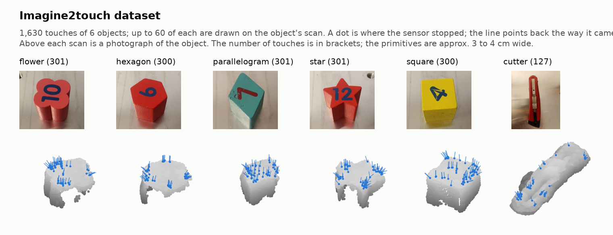
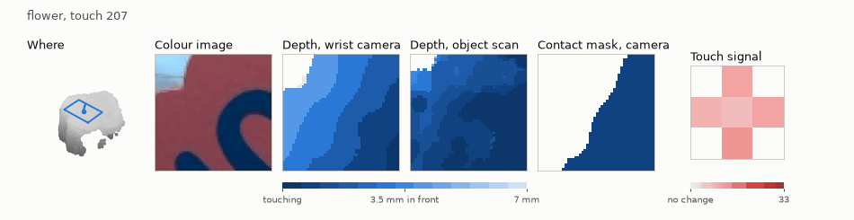

# Imagine2touch

Imagine2touch predicts what a touch sensor will feel from a depth image of the surface it is about to
touch. A robot with such a model can compare what it feels with what it expected for each object it
has in mind, and so recognise an object by touch. The sensor is a [ReSkin](https://reskin.dev): five
magnetometers under a magnetic skin, 15 numbers per touch.

This is the code and data of

> A. Ayad, A. Röfer, N. Heppert and A. Valada, "Imagine2touch: Predictive Tactile Sensing for Robotic
> Manipulation using Efficient Low-Dimensional Signals", ViTac workshop, ICRA 2024, Yokohama.
> [arXiv:2405.01192](https://arxiv.org/abs/2405.01192)

<p align="center">
  
  <br><em>The dataset of the paper (sessions v_0): 1,630 touches of six objects. A Franka arm looks at a patch of the object with
  the camera at its wrist, then moves the sensor onto that patch until it feels it.</em>
</p>

<p align="center">
  
  <br><em>More touches, five of each object.</em>
</p>

A second dataset asks whether the sensor can tell shapes smaller than itself apart:

<p align="center">
  
  <br><em>The shape classification dataset: 1,280 presses of five stamps into the mounted sensor.</em>
</p>

## Getting started

```bash
python -m venv .venv && source .venv/bin/activate
pip install -e .
```

Any Python from 3.8 on works; the code is developed on 3.12. Only the real robot ties you to a
version: its ROS client runs on Python 3.8 (see [Running on the robot](docs/running_on_the_robot.md)).

Download the two datasets, `imagine2touch.npz` (8 MB) and `shape_classification.npz`, from
[this folder](https://drive.google.com/drive/folders/1R-VS56TSSfveVk3LtNUCnogSlWpfhxf7?usp=sharing)
into `data/`.

Alternatively, rebuild `imagine2touch.npz` from the
[raw recordings](https://drive.google.com/drive/folders/1dU-ReQk-5dL5UJNuePnRpuHHKqbfHsXU?usp=drive_link):

```bash
python -m imagine2touch.datasets.recordings.recording_reducer --source PATH/TO/Imagine2touch_data
```

## Experiments

```bash
python scripts/run_benchmark.py        # run the experiments
python scripts/report_benchmark.py     # tables and the t-SNE figure, into results/benchmark/
```

The benchmark runs the paper's two experiments:

- **Shape classification** (Table I): name the stamp pressed into the sensor from its signal.
- **Object recognition** (Table II): done on the robot in the paper; here a simulated robot repeats it on
  the recorded scans and signals, as an alternative that needs no hardware.

and measures two parts of its method, which the paper describes but does not evaluate by themselves:

- **Correspondence** (Fig. 2): do touches with similar masks give similar signals?
- **Touch prediction** (Sec. II): train the model and measure how well it predicts the signal of objects
  it has not seen.

Every setting is in `configs/benchmark.yaml`. A stopped run continues where it left off.

Object recognition runs on the v6 sessions. Download
[`imagine2touch_v6.npz`](https://drive.google.com/file/d/1IrnuDb2HVsy9HwKKDEdWbHdBmIlNUgbA/view?usp=drive_link)
(13 MB) into `data/`, then:

```bash
python scripts/run_benchmark.py --config configs/v6.yaml --results results/v6
python scripts/report_benchmark.py --results results/v6
```

## Recognising objects by touch

Outside the benchmark, two scripts train the touch model and recognise a single object with it. The
first trains the model on the training objects of the configuration and saves it. The second puts an object in front of a robot
that does not know which one it is: the robot touches it, compares each touch with what the model
predicts for every candidate object, and names the candidate that fits best. `--help` lists what each
script lets you choose.

```bash
python -m imagine2touch.experiments.scripts.train_model
python -m imagine2touch.procedures.scripts.recognize_object --simulate --object star
```

With `--simulate` no hardware is needed: a simulated robot touches the scan of the object and feels
the signals the real sensor recorded there. Without it, the same code drives a Franka arm, a ReSkin
and a RealSense camera. [Running on the robot](docs/running_on_the_robot.md) covers that setup, from
calibrating the camera to collecting new touches.

## What depends on what

<p align="center">
  
  <br><em>An arrow points from a package to one it imports; every direct import between packages
  is drawn. The scripts list the packages they import as tags.</em>
</p>

## Citation

```bibtex
@inproceedings{ayad2024imagine2touch,
  title     = {Imagine2touch: Predictive Tactile Sensing for Robotic Manipulation using Efficient Low-Dimensional Signals},
  author    = {Ayad, Abdallah and R{\"o}fer, Adrian and Heppert, Nick and Valada, Abhinav},
  booktitle = {ViTac Workshop, IEEE International Conference on Robotics and Automation (ICRA)},
  year      = {2024}
}
```

Questions: abdallahayman772@gmail.com.

Licence: [PolyForm Noncommercial 1.0.0](LICENSE). Free to use for research and other non-commercial
purposes.
