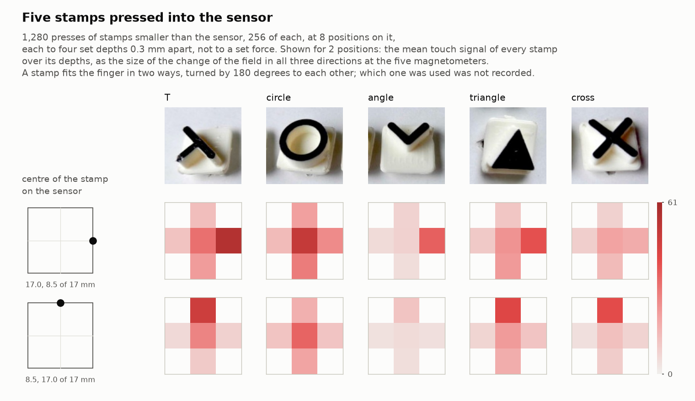
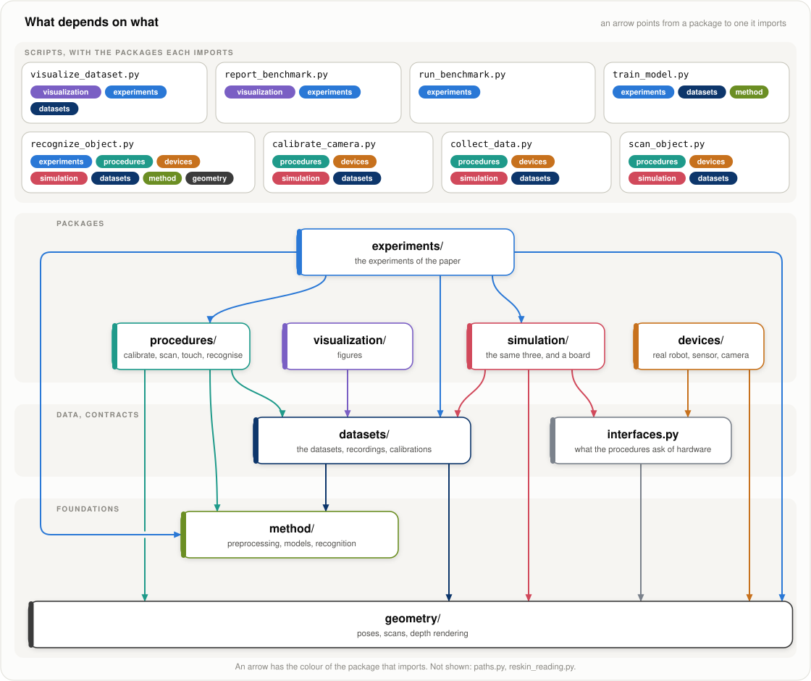

# Imagine2touch

Imagine2touch predicts what a touch sensor will feel from a depth image of the surface it is about to
touch. A robot with such a model can compare what it feels with what it expected for each object it
has in mind, and so recognise an object by touch. The sensor is a [ReSkin](https://reskin.dev): five
magnetometers under a magnetic skin, 15 numbers per touch.

This is the code and data of

> A. Ayad, A. Röfer, N. Heppert and A. Valada, "Imagine2touch: Predictive Tactile Sensing for Robotic
> Manipulation using Efficient Low-Dimensional Signals", ViTac workshop, ICRA 2024, Yokohama.
> [arXiv:2405.01192](https://arxiv.org/abs/2405.01192)

<p align="center">
  
  <br><em>The dataset of the paper (sessions v_0): 1,630 touches of six objects. A Franka arm looks at a patch of the object with
  the camera at its wrist, then moves the sensor onto that patch until it feels it.</em>
</p>

<p align="center">
  
  <br><em>More touches, five of each object.</em>
</p>

A second dataset asks whether the sensor can tell shapes smaller than itself apart:

<p align="center">
  
  <br><em>The shape classification dataset: 1,280 presses of five stamps into the mounted sensor, each to
  one of four set depths 0.3 mm apart, not to a set force. A
  stamp fits the finger in two ways, turned by 180 degrees to each other; which one was used was not recorded.</em>
</p>

## Getting started

```bash
python -m venv .venv && source .venv/bin/activate
pip install -e .
```

Any Python from 3.8 on works; the code is developed on 3.12. Only the real robot ties you to a
version: its ROS client runs on Python 3.8 (see [Running on the robot](docs/running_on_the_robot.md)).

Download the two datasets, `imagine2touch.npz` (8 MB) and `shape_classification.npz`, from
[this folder](https://drive.google.com/drive/folders/1R-VS56TSSfveVk3LtNUCnogSlWpfhxf7?usp=sharing)
into `data/`.

Alternatively, rebuild `imagine2touch.npz` from the
[raw recordings](https://drive.google.com/drive/folders/1dU-ReQk-5dL5UJNuePnRpuHHKqbfHsXU?usp=drive_link):

```bash
python -m imagine2touch.datasets.recordings.recording_reducer --source PATH/TO/Imagine2touch_data
```

## Experiments

```bash
python scripts/run_benchmark.py        # run the experiments
python scripts/report_benchmark.py     # tables and the t-SNE figure, into results/benchmark/
```

The benchmark runs the paper's two experiments:

- **Shape classification** (Table I): name the stamp pressed into the sensor from its signal.
- **Object recognition** (Table II): done on the robot in the paper; here a simulated robot repeats it on
  the recorded scans and signals, for both of the paper's object sets: the primitives and the tools.

and measures two parts of its method, which the paper describes but does not evaluate by themselves:

- **Correspondence** (Fig. 2): do touches with similar masks give similar signals?
- **Touch prediction** (Sec. II): train the model and measure how well it predicts the signal of objects
  it has not seen.

Every setting is in `configs/benchmark.yaml`. A stopped run continues where it left off.

The trained weights, one file per seed, are in
[this folder](https://drive.google.com/drive/folders/1P66Ftne3HvHGfzJrjKy9DqyUtpefgg3b?usp=sharing):
the five recognition models, `touch_scan_seed0.pt` to `touch_scan_seed4.pt` (20 MB each), and the five
shape classifiers, `shape_classifier_seed0.pt` to `shape_classifier_seed4.pt`.
Put into `results/benchmark/models/`, the benchmark uses them and gives the tables below
exactly; without them it trains its own, which differ slightly from one computer to another.
`TouchModel.load(path)` and `ShapeClassifier.load(path)` load one for use elsewhere.

The numbers below are means over five seeds, each training its own models.

**Shape classification**: share of the test presses named correctly.

| | T | circle | angle | triangle | cross | all |
|:--|--:|--:|--:|--:|--:|--:|
| This repository | 0.84 | 0.91 | 0.92 | 0.86 | 0.92 | 0.89 |
| Paper, Table I | 0.91 | 0.90 | 0.90 | 0.95 | 0.94 | 0.92 |
| Chance | 0.20 | 0.20 | 0.20 | 0.20 | 0.20 | 0.20 |

The data and its split are those of the paper's code: 256 presses of every stamp, of which 181 train
the classifier, 25 are set aside for validation and 50 test it. The paper states "trained on 80%",
which is the 181 and the 25 together. The paper reports one training; the five here lie between 0.84
and 0.93 for all stamps.

**Object recognition, primitives**: the simulated robot touches parallelogram, square or star ten times and chooses
among the three. One such round of ten touches is a trial; each object gets twenty trials with each of
the five models. The model is trained on flower and hexagon only, on
depth images of their scans. Where the sensor meets the object, both methods are scored from the real
touch recorded nearest to it. The columns give the share of single touches that vote for the touched
object, and the share of trials that name it.

| | parallelogram | square | star | mean | named after ten touches (trials) |
|:--|--:|--:|--:|--:|--:|
| Touch model | 61% | 47% | 55% | 54% | 72% (300) |
| Proprioception | 23% | 70% | 59% | 50% | 59% (300) |
| Paper's robot, touch model | 40% | 70% | 40% | 50% | 100% (3) |
| Paper's robot, proprioception | 30% | 20% | 20% | 23% | 0% (3) |
| Chance | 33% | 33% | 33% | 33% | 33% |

The paper's rows are one run of ten touches per object on the real robot (Table II). A single such
trial of the simulated robot varies by about 15 points.

**Object recognition, tools**: the same test and the same model with the paper's second set, a box
cutter and a hanger. The robot touches the cutter; the hanger was only scanned, so it cannot
be the touched object.

| | votes for the cutter | named after ten touches (trials) |
|:--|--:|--:|
| Touch model | 76% | 87% (100) |
| Proprioception | 79% | 78% (100) |
| Paper's robot, touch model | 60% | 100% (1) |
| Paper's robot, proprioception | 100% | 100% (1) |
| Chance | 50% | 50% |

The paper's Table II gives 70% and 80% for the tools: the means of this run on the cutter and of
one on the hanger (80% and 60%).

## Recognising objects by touch

Two scripts work outside the benchmark. The first trains the touch model and saves it. The second puts an object in front of a robot
that does not know which one it is: the robot touches it, compares each touch with what the model
predicts for every candidate object, and names the candidate that fits best. `--help` lists what each
script lets you choose.

```bash
python -m imagine2touch.experiments.scripts.train_model
python -m imagine2touch.procedures.scripts.recognize_object --simulate --object star
```

With `--simulate` no hardware is needed: a simulated robot touches the scan of the object and feels
the signals the real sensor recorded there. Without it, the same code drives a Franka arm, a ReSkin
and a RealSense camera. [Running on the robot](docs/running_on_the_robot.md) covers that setup, from
calibrating the camera to collecting new touches.

## What depends on what

<p align="center">
  
  <br><em>An arrow points from a package to one it imports; every direct import between packages
  is drawn. The scripts list the packages they import as tags.</em>
</p>

## Citation

```bibtex
@inproceedings{ayad2024imagine2touch,
  title     = {Imagine2touch: Predictive Tactile Sensing for Robotic Manipulation using Efficient Low-Dimensional Signals},
  author    = {Ayad, Abdallah and R{\"o}fer, Adrian and Heppert, Nick and Valada, Abhinav},
  booktitle = {ViTac Workshop, IEEE International Conference on Robotics and Automation (ICRA)},
  year      = {2024}
}
```

Questions: abdallahayman772@gmail.com.

Licence: [PolyForm Noncommercial 1.0.0](LICENSE). Free to use for research and other non-commercial
purposes.
